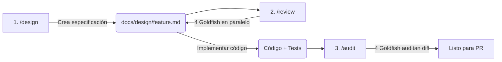

# EGM Ágil para OpenCode (`egm-es-opencode`)

> **Diseña con un Elefante. Revisa y audita con 4 Goldfish (Arquitectura, UX/UI, Seguridad y Pruebas).**

Versión minimalista, ágil y en español del [Elephant-Goldfish Model (EGM)](https://github.com/google/elephant-goldfish-model), diseñada nativamente para **OpenCode** y ampliada para cubrir **Experiencia de Usuario (UX/UI)**, **Seguridad (STRIDE/OWASP)** y **Calidad de Pruebas (Testing)** tanto en la fase de diseño como sobre el código implementado.

---

## ¿Por qué esta versión?

El modelo original demuestra que **«el diseño es el nuevo código»**: separar la sesión que diseña con contexto profundo (**El Elefante**) de sesiones efímeras sin memoria previa (**Los Goldfish**) evita el sesgo de confirmación y las cascadas de alucinaciones.

Sin embargo, para mantener una alta velocidad de desarrollo, esta versión elimina la burocracia innecesaria:

- **1 único documento vivo por funcionalidad** en `docs/design/<feature>.md` (sin archivos intermedios descartables en la raíz).
- **4 comandos directos** (`/design`, `/review`, `/audit`, `/context`) con todo el razonamiento, prompts y artefactos en **español**.
- **1 sola ola paralela de revisión** con **4 Goldfish especializados** (en lugar de 5 etapas secuenciales y 10 subagentes).
- **Cero ruido (*No Nits*)**: Los Goldfish tienen prohibido reportar detalles cosméticos; solo informan problemas `[BLOQUEANTE]` o `[IMPORTANTE]`.

---

## Arquitectura de Agentes


| Agente                         | Rol y Memoria                   | Permisos                                        | Responsabilidad                                                                                                                                                                                                                                                                                                   |
| :------------------------------ | :------------------------------- | :----------------------------------------------- | :----------------------------------------------------------------------------------------------------------------------------------------------------------------------------------------------------------------------------------------------------------------------------------------------------------------- |
| 🐘 **`elephant`**              | **Primario (Memoria Profunda)** | Lectura, edición, ejecución y delegación `task` | Entrevista al desarrollador, redacta `docs/design/<feature>.md`, coordina a los Goldfish e implementa código con guardarraíles.                                                                                                                                                                                   |
| 🐟 **`goldfish-architecture`** | **Subagente (Memoria Cero)**    | Solo lectura (`read`, `glob`; sin `.env`)       | **En Diseño:** Test de comprensión (paráfrasis en frío), simplicidad (YAGNI), reutilización y Regla de Cero Decisiones.<br>**En Código:** Detecta deriva entre `docs/design/` y el `git diff`.                                                                                                                    |
| 🎨 **`goldfish-ux`**           | **Subagente (Memoria Cero)**    | Solo lectura (`read`, `glob`; sin `.env`)       | **En Diseño:** Historias de usuario (`Dado/Cuando/Entonces`), flujos UX/UI, estados vacíos/carga/error, accesibilidad y ergonomía CLI/API.<br>**En Código:** Verifica que estados límite, mensajes de error y accesibilidad estén realmente implementados.                                                        |
| 🛡️ **`goldfish-security`**    | **Subagente (Memoria Cero)**    | Solo lectura (`read`, `glob`; sin `.env`)       | **En Diseño:** Audita los **7 Vectores Mayores/Clásicos (`V1`–`V7`)** y el **Impacto Retroadaptativo (`R1`–`R5`)** sobre módulos ya armados.<br>**En Código:** Auditoría AppSec (OWASP Top 10 / CWE) y verificación de parches retroactivos en el `git diff`.                                                     |
| 🧪 **`goldfish-testing`**      | **Subagente (Memoria Cero)**    | Solo lectura (`read`, `glob`; sin `.env`)       | **En Diseño:** Audita los **5 Niveles de Verificación (`N1`–`N5`)**, incluyendo unitarios de frontera, integración y **Playwright E2E (`N4`)**.<br>**En Código:** Caza **tests tautológicos** (*mock-testing-mock*), aserciones débiles y antipatrones en Playwright (`waitForTimeout`, selectores CSS frágiles). |


---

## Estrategia de Testing en 5 Niveles (`N1`–`N5`) y Validación con Playwright

Definida en `.opencode/skills/egm-workflow/testing_strategy.md`, el Elefante y `goldfish-testing` exigen y auditan 5 niveles complementarios de verificación según la arquitectura que se va armando:


| Nivel    | Tipo de Verificación                                               | Qué Exige en Diseño (`/review`) y Qué Audita en Código (`/audit`)                                                                                                                                                                                                                                                                                                                                                                                                                                                                                                                         |
| :-------- | :------------------------------------------------------------------ | :----------------------------------------------------------------------------------------------------------------------------------------------------------------------------------------------------------------------------------------------------------------------------------------------------------------------------------------------------------------------------------------------------------------------------------------------------------------------------------------------------------------------------------------------------------------------------------------- |
| **`N1`** | **Análisis Estático, Tipado y Calidad de Código**                  | Compilación/Typecheck (`tsc --noEmit`, `pyrefly`/`mypy`, `cargo check`) y linting (`eslint`, `ruff`, `clippy`). Prohibido silenciar errores con `any`, `@ts-ignore` o `# type: ignore` sin justificación técnica.                                                                                                                                                                                                                                                                                                                                                                         |
| **`N2`** | **Testing Unitario y Valores Frontera (*Boundary*)**               | Pruebas deterministas en milisegundos (sin red, disco ni reloj real) en `vitest`/`jest`/`pytest`/`cargo test`. Exige casos límite (`0`, `-1`, vacío, `null`, máximo tamaño) y aplica la **Regla de Oro de Mocks**: solo se mockean fronteras externas; mockear la unidad bajo prueba es un fallo `[BLOQUEANTE]`.                                                                                                                                                                                                                                                                          |
| **`N3`** | **Testing de Integración, Contratos de API y BD**                  | Pruebas reales sobre rutas HTTP/CLI (`supertest`, `httpx`/`TestClient`), validación de esquemas (Zod/Pydantic) y persistencia contra BD real/efímera con aislamiento transaccional entre tests.                                                                                                                                                                                                                                                                                                                                                                                           |
| **`N4`** | **Validación E2E y Visual/UI con Playwright (`@playwright/test`)** | **Obligatorio si hay interfaz Web:**<br>1. Valida cada Historia (`HU-X`) en navegador real (`chromium`/`firefox`/`webkit`).<br>2. Exige selectores semánticos/accesibles (`getByRole`, `getByLabel`, `getByText`) y prohíbe selectores CSS frágiles.<br>3. Verifica la **Tríada de Estados UX** en el DOM: *Estado Vacío*, *Estado de Carga* y *Estado de Error* (simulando fallos con `page.route()` y comprobando `getByRole('alert')`).<br>4. Prohíbe `waitForTimeout()` arbitrarios (exige *web-first assertions* `await expect(...).toBeVisible()`) y vigila `pageerror` en consola. |
| **`N5`** | **Testing de Seguridad (`V1`–`V7`) y Regresión (`R1`–`R5`)**       | Pruebas negativas activas (intentos de BOLA/IDOR cross-tenant esperando `403/404`, payloads SQLi/XSS/Path Traversal/CSV Injection esperando rechazo, `Promise.all` para condiciones de carrera `V4` TOCTOU) y ejecución de tests de módulos previos ante cambios retroadaptativos.                                                                                                                                                                                                                                                                                                        |


---

## Seguridad Clásica/Mayor (`V1`–`V7`) + Motor Retroadaptativo (`R1`–`R5`)

Definidos en `.opencode/skills/egm-workflow/security_vectors.md`, el Elefante y `goldfish-security` combinan dos capas de protección:

### 1. Los 7 Vectores Mayores y Clásicos (`V1` – `V7`)


| Vector   | Familia de Amenazas (OWASP / STRIDE / CWE)                   | Qué Audita en Diseño (`/review`) y Código (`/audit`)                                                                                                                                                                       |
| :-------- | :------------------------------------------------------------ | :-------------------------------------------------------------------------------------------------------------------------------------------------------------------------------------------------------------------------- |
| **`V1`** | **Control de Acceso y Autorización (OWASP A01)**             | **BOLA / IDOR** (acceso por ID sin filtrar por dueño/`tenant_id`), **BFLA** (funciones admin sin rol), **Mass Assignment** (`role`, `isAdmin` en body), bypass de middlewares y CORS permisivo.                            |
| **`V2`** | **Autenticación, Sesiones, Cripto y Secretos (A02, A07)**    | JWT (`alg: none`, expiración, rotación/revocación), Cookies (`HttpOnly`, `Secure`, `SameSite`), contraseñas (`Argon2id`/`bcrypt`), comparación en tiempo constante, PRNG criptográfico, fuerza bruta y secretos en código. |
| **`V3`** | **Inyecciones y Fronteras de Confianza (OWASP A03)**         | SQL/NoSQL/ORM Injection, OS Command Injection (`shell=True`), XSS / SSTI, **Path Traversal** (`realpath` + prefijo + symlinks), **CSV Formula Injection** (`=`, `+`, `-`, `@`), XXE y deserialización insegura.            |
| **`V4`** | **Lógica de Negocio y Condiciones de Carrera (A04, A08)**    | **TOCTOU / Race Conditions** (doble gasto, cupones, saldo o cuotas en paralelo sin bloqueo atómico/`FOR UPDATE`), salto de etapas en flujos multi-paso, firmas HMAC y `Idempotency-Key` en webhooks/pagos.                 |
| **`V5`** | **Red, SSRF, Subida de Archivos y Configuración (A05, A10)** | **SSRF** (bloqueo de `169.254.169.254`, `localhost` y RFC1918 + redirecciones), **CSRF**, subida de archivos (*magic bytes*, UUID, almacenamiento fuera de webroot, `nosniff`) y cabeceras (`CSP`, `HSTS`).                |
| **`V6`** | **Disponibilidad (DoS), Recursos y Observabilidad (A09)**    | Paginación y tope `limit` obligatorio, streaming de archivos, ReDoS, `timeout` en llamadas externas, *Rate Limiting*, prohibición de PII/tokens/stack traces en logs o respuestas de error y *Audit Trail*.                |
| **`V7`** | **Supply Chain e IA / LLMs (A06 &amp; OWASP LLM Top 10)**    | Dependencias mínimas con *lockfile*, **Prompt Injection** directo e indirecto, sanitización de salidas de LLM antes de ejecutar/renderizar, permisos mínimos en tools y tope de tokens (*Denial of Wallet*).               |


### 2. Seguridad Retroadaptativa: Se adapta a medida que armas el proyecto (`R1` – `R5`)

La seguridad de una aplicación cambia cada vez que agregas una pieza nueva. En lugar de auditar cada funcionalidad de forma aislada, el sistema ejecuta **5 Disparos Retroadaptativos** que obligan a actualizar lo que ya construiste en fases previas:

- `R1` **(De Abierto/Monousuario → Autenticado o Multi-Tenant):** Cuando agregas login, roles u organizaciones en la iteración `N`, el diseño y el Plan de Archivos deben incluir la adaptación retroactiva de los endpoints y queries creados en `00..N-1` para filtrar por `user_id`/`tenant_id` (evitando BOLA/IDOR en módulos antiguos).
- R2 **(De Datos Internos → Entrada Externa / Asíncrona):** Si un servicio creado antes para uso interno pasa a recibir datos de un webhook, archivo subido, API pública o LLM, su frontera de confianza cambió y se exige endurecer retroactivamente su validación y timeouts.
- R3 **(Nuevo Rol, Estado de Cuenta o Suscripción):** Si introduces estados como *usuario suspendido*, *plan expirado* o *recurso archivado*, los endpoints de iteraciones previas deben adaptarse para respetar ese nuevo estado.
- R4 **(Nuevos Datos Sensibles / PII en Modelos Existentes):** Si agregas campos sensibles (tokens, teléfono, documento) a un modelo existente, los listados, exportadores CSV y loggers previos se adaptan retroactivamente para no filtrarlos.
- R5 **(De Síncrono → Concurrencia / Workers / Escala):** Si una operación previa pasa a ejecutarse en paralelo o por colas, se audita y adapta retroactivamente contra condiciones de carrera (`V4` TOCTOU) e idempotencia.

---

## Flujo de Trabajo en 4 Comandos



### 1. `/context` — Alimentar al Elefante (Opcional, para proyectos existentes)

```text
/context
```

Explora el repositorio y genera/actualiza `docs/CONTEXT.md` con un mapa compacto de módulos, patrones UX/UI, invariantes de seguridad y comandos de test.

### 2. `/design <idea>` — Co-diseñar con el Elefante

```text
/design Añadir autenticación por magic link con límite de intentos
```

1. El Elefante aplica la **Regla Cero Código** y te hace entre **2 y 4 preguntas directas** sobre alcance, estados UX/UI, riesgos de seguridad y pruebas.
2. Con tus respuestas, genera directamente `docs/design/<feature>.md` siguiendo la plantilla unificada (`.opencode/skills/egm-workflow/design_template.md`).

### 3. `/review [ruta]` — Validar el diseño con los 4 Goldfish

```text
/review docs/design/magic-link-auth.md
```

1. El Elefante lanza **en paralelo y sin memoria previa** a `goldfish-architecture`, `goldfish-ux`, `goldfish-security` y `goldfish-testing` en `MODO: DISENO`.
2. Te muestra primero la **Paráfrasis de Comprensión** (para verificar que un lector sin contexto entiende el documento) y una lista consolidada de hallazgos (`[CORREGIR]` o `[IMPUGNAR]`).
3. Tras tu aprobación, actualiza `docs/design/magic-link-auth.md` y lo marca como `Aprobado para Implementación`.

> **Implementación:** Una vez aprobado el diseño, pídele al Elefante:
> *"Implementa `docs/design/magic-link-auth.md` siguiendo el plan de archivos."*

### 4. `/audit [ruta]` — Auditar el código, UX, tests y seguridad antes del PR

```text
/audit docs/design/magic-link-auth.md
```

1. Ejecuta la suite de tests del proyecto.
2. Lanza en paralelo a los **4 Goldfish en `MODO: CODIGO`** sobre el `git diff` y los archivos nuevos.
3. Si no hay deriva, las historias y estados UX se cumplen, no hay vulnerabilidades y los tests no son tautológicos, recibes **`[✅ AUDITORÍA COMPLETA: LISTO PARA PR]`**.

---

## Tutorial Paso a Paso: Crear un Proyecto Desde Cero con la Plantilla

A continuación tienes el recorrido completo desde que creas un repositorio nuevo a partir de esta plantilla hasta tener tu aplicación construida, probada y auditada:

### Paso 1: Crear tu nuevo repositorio desde la plantilla y abrir OpenCode

Puedes crear tu proyecto desde el botón **"Use this template"** en GitHub o directamente desde tu terminal con GitHub CLI:

```bash
gh repo create mi-nuevo-proyecto --template JoCGM09/egm-es-opencode --public --clone
cd mi-nuevo-proyecto
opencode
```

\*(Al abrir `opencode`, `opencode.json` activará automáticamente al agente primario **`elephant`**).\*

---

### Paso 2: Diseñar la Arquitectura Base / MVP desde cero (`/design`)

Con el repositorio aún en blanco (sin código de aplicación), inicia el co-diseño de tu proyecto describiendo tu idea:

```text
/design Quiero crear desde cero una aplicación web de gestión de tareas para equipos con autenticación, tableros Kanban y API REST
```

- **Qué hace el Elefante (Entrevista Socrática — Cero Código):**
Antes de tocar un solo archivo o ejecutar `npm init`, el Elefante detecta que es un **proyecto desde cero** y te hace de **2 a 4 preguntas estratégicas**:
  > 1. **Stack y Alcance del MVP:** ¿Prefieres algún stack concreto (ej. Next.js + SQLite/Postgres, FastAPI + React) y qué funcionalidades entran estrictamente en la v1 frente a cuáles dejamos fuera (YAGNI)?
  > 2. **UX/UI e Historias de Usuario:** ¿Cuáles son los viajes críticos del usuario en el MVP y cómo deben comportarse los estados vacíos (tablero nuevo sin tareas), de carga y de error?
  > 3. **Seguridad desde el Día 1:** ¿Cómo se gestionarán las sesiones/tokens, el aislamiento de datos entre distintos equipos (autorización) y las variables de entorno?
  > 4. **Estrategia de Pruebas:** ¿Qué framework de testing usaremos para pruebas unitarias/integración y qué flujos críticos deben quedar cubiertos desde el esqueleto inicial?
- **Tu respuesta:** Respondes en el chat definiendo tus preferencias.
- **Resultado:** El Elefante genera `docs/design/00-arquitectura-base.md` con el diseño fundacional del proyecto: Historias de Usuario (`Dado/Cuando/Entonces`), Estados UX/UI, Arquitectura y Stack, Alternativas Descartadas, Modelo de Amenazas STRIDE, **Plan de Archivos inicial completo (`[Crear]`)** y Matriz de Pruebas.

---

### Paso 3: Validar el diseño fundacional con los 4 Goldfish (`/review`)

Antes de construir el esqueleto del proyecto, pon a prueba el diseño con ojos frescos:

```text
/review docs/design/00-arquitectura-base.md
```

- **Qué ocurre por debajo:**
El Elefante lanza **en paralelo 4 subagentes con memoria cero** (no conocen tu conversación previa):
  1. 🐟 `goldfish-architecture`: Escribe una **Paráfrasis de Comprensión** de 3 líneas para demostrar que el proyecto se entiende por sí solo, verifica que el stack y estructura de carpetas no tengan sobreingeniería (YAGNI) y comprueba la **Regla de Cero Decisiones** (que todos los archivos a crear estén especificados sin ambigüedades).
  2. 🎨 `goldfish-ux`: Verifica que cada historia de usuario del MVP tenga criterios `Dado/Cuando/Entonces` verificables, flujos coherentes, accesibilidad y estados vacíos/carga/error definidos.
  3. 🛡️ `goldfish-security`: Audita el modelo de amenazas inicial (autenticación, autorización entre recursos, validación de entradas, manejo de secretos) y exige que cada control esté asignado a un archivo en el Plan de Archivos.
  4. 🧪 `goldfish-testing`: Verifica que la arquitectura propuesta sea determinísticamente testeable y que todas las historias y controles de seguridad tengan su prueba en la Matriz de Pruebas.
- **Aprobación:**
El Elefante resume los hallazgos en el chat marcados como `[CORREGIR]` o `[IMPUGNAR]`. Confirmas:
  ```text
  Aplica las correcciones propuestas
  ```
  El documento \`docs/design/00-arquitectura-base.md\` se actualiza y queda marcado como \*\*\`Aprobado para Implementación\`\*\*.

---

### Paso 4: Construir el proyecto desde cero con guardarraíles

Ahora sí, pídele al Elefante que materialice el proyecto siguiendo el diseño aprobado:

```text
Implementa docs/design/00-arquitectura-base.md siguiendo exactamente el Plan de Archivos y el Plan de Pruebas.
```

- **Qué ocurre:** El Elefante inicializa los manifiestos y dependencias acordadas, crea toda la estructura de carpetas, implementa los módulos, pantallas/endpoints, controles de seguridad y escribe la suite de pruebas iniciales sin salirse del alcance diseñado.

---

### Paso 5: Auditar el código recién creado (`/audit`) y fijar el mapa (`/context`)

Para cerrar la creación de la base del proyecto:

1. **Audita la implementación y los tests con los 4 Goldfish en `MODO: CODIGO`:**
   ```text
    /audit docs/design/00-arquitectura-base.md
   ```
   - Ejecuta los tests del proyecto.
   - Los 4 Goldfish auditan los archivos creados verificando que no falte nada del diseño (`goldfish-architecture`), que los estados UX y errores estén programados (`goldfish-ux`), que no se hayan introducido vulnerabilidades OWASP (`goldfish-security`) y que los tests sean reales y no tautológicos (`goldfish-testing`).
   - Recibes el sello **`[✅ AUDITORÍA COMPLETA: LISTO PARA PR]`**.
2. **Registra el mapa de contexto del proyecto recién nacido:**
   ```text
    /context
   ```
   - Genera `docs/CONTEXT.md` con el resumen de la arquitectura, módulos, patrones UX, invariantes de seguridad y comandos de test que acabas de crear.

---

### Paso 6: Desarrollar las siguientes funcionalidades (`01`, `02`, ...)

A partir de aquí, para cada nueva funcionalidad que quieras añadir a tu proyecto, repites siempre el mismo ciclo ágil:

1. `/design <nueva funcionalidad>` → Crea `docs/design/01-notificaciones.md` (apoyándose automáticamente en `docs/CONTEXT.md`).
2. `/review docs/design/01-notificaciones.md` → Los 4 Goldfish blindan el diseño.
3. `Implementa docs/design/01-notificaciones.md` → Construcción directa.
4. `/audit docs/design/01-notificaciones.md` → Auditoría de código, UX, tests y seguridad antes del commit/PR.
5. `/context` → Actualiza `docs/CONTEXT.md` si añadiste nuevos módulos principales.

---

## También puedes integrarlo en un proyecto ya existente

Si en lugar de empezar desde cero ya tienes un repositorio con código y quieres incorporarle este flujo:

```bash
git remote add egm-template https://github.com/JoCGM09/egm-es-opencode.git
git fetch egm-template
git checkout egm-template/main -- .opencode opencode.json AGENTS.md docs/design
git remote remove egm-template
```

En ese caso, simplemente abre `opencode`, ejecuta primero `/context` para que el Elefante mapee tu código existente en `docs/CONTEXT.md`, y continúa desde el **Paso 6**.

> **Nota de OpenCode:** Recuerda cerrar y reiniciar `opencode` después de añadir o modificar agentes, comandos o `opencode.json` para que cargue la nueva configuración.

## Verificación del repositorio

Para validar que el esquema de `opencode.json`, los permisos de solo lectura de los Goldfish, las skills y los comandos son válidos:

```bash
python scripts/verify.py
```

